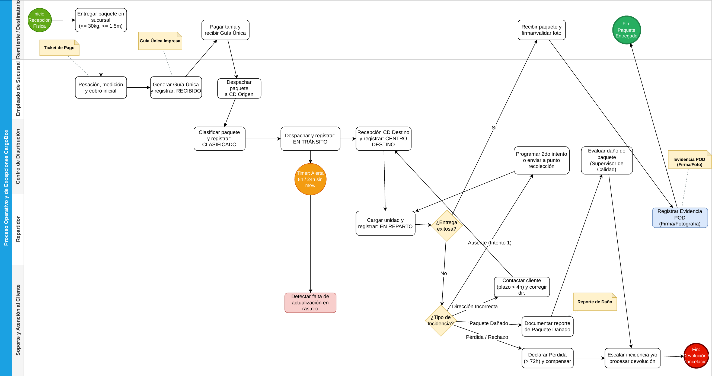

# Análisis del negocio (Unidad 2)

Artefactos originales de análisis de CargoBox, elaborados por el Equipo 14 en la Unidad 2 y usados como base del PIA:

| Archivo | Contenido |
|---|---|
| `BRD_Equipo14_CLNEG.pdf` | Business Requirements Document original (la versión refinada para el PIA es `docs/BRD.md`) |
| `User_Stories_Equipo14_CLNEG.pdf` | 17 historias de usuario con criterios de aceptación (con Gherkin en `docs/user-stories.md`) |
| `Glosario_Dominio_Equipo14_CLNEG.pdf` | Glosario de dominio (con su relación al código en `docs/glosario.md`) |
| `BPMN_Equipo14_CLNEG.pdf` / `BPMN_Equipo14.png` | Proceso operativo y de excepciones de CargoBox |

