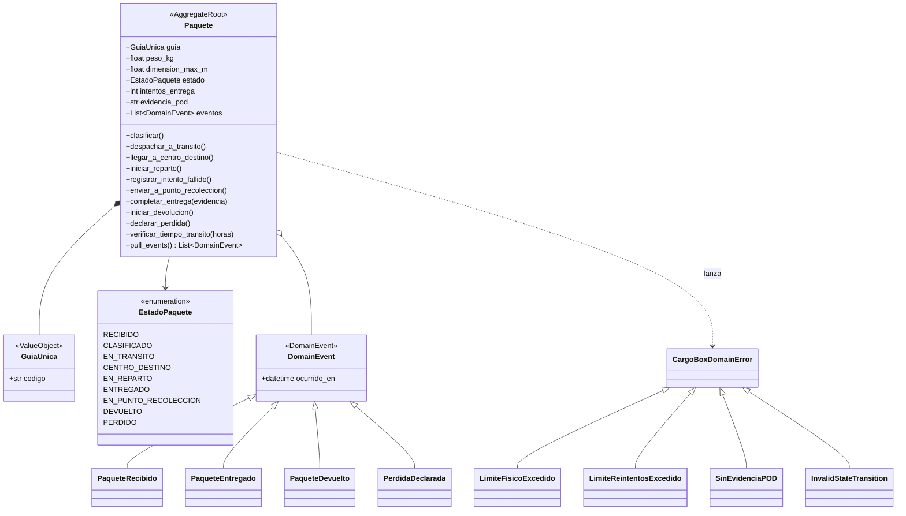

# Modelo de dominio (DDD)

El dominio de CargoBox es el ciclo de vida de un envío: desde que el paquete se recibe en sucursal hasta que se entrega, se resguarda, se devuelve o se declara perdido. Todo el modelo vive en `src/domain/__init__.py` y no depende de ningún framework.

## Lenguaje ubicuo

| Término | Significado en el negocio | Dónde aparece en el código |
|---|---|---|
| Paquete | Envío físico que CargoBox recibe, transporta y entrega | `Paquete` (raíz del agregado) |
| Guía única | Código que identifica a un paquete durante todo su recorrido | `GuiaUnica` (Value Object) |
| Estado | Etapa operativa en la que se encuentra el paquete | `EstadoPaquete` (enum) |
| Intento de entrega | Visita del repartidor al domicilio | `Paquete.intentos_entrega` |
| Punto de recolección | Sucursal donde se resguarda el paquete tras dos visitas fallidas | `EstadoPaquete.EN_PUNTO_RECOLECCION` |
| POD (Proof of Delivery) | Firma digital o fotografía que demuestra la entrega | `Paquete.evidencia_pod` |
| Incidencia | Situación que interrumpe el flujo normal: dirección incorrecta, daño, pérdida o rechazo | `CargoBoxService.procesar_incidencia` |

## Bounded context

El sistema implementa un solo contexto delimitado, **Trazabilidad de Envíos**. Las tarifas, los pagos y la geolocalización quedaron fuera de alcance en el BRD (sección 4) y por eso no se modelan.

## Agregado `Paquete`

`Paquete` es la raíz del agregado: cualquier cambio de estado pasa por sus métodos, y ninguno deja al paquete en una situación inválida.

| Elemento | Tipo DDD | Responsabilidad |
|---|---|---|
| `Paquete` | Entidad / raíz de agregado | Protege las invariantes y controla las transiciones de estado |
| `GuiaUnica` | Value Object (`frozen=True`) | Identidad inmutable; rechaza códigos vacíos |
| `EstadoPaquete` | Enumeración de dominio | Catálogo cerrado de los 9 estados válidos |
| `DomainEvent` y subclases | Eventos de dominio | Registran hechos relevantes del negocio |
| `CargoBoxDomainError` y subclases | Excepciones de dominio | Expresan cada regla rota con un nombre del negocio |

### Invariantes que protege el agregado

1. **Restricciones físicas (RN del BRD 7.3):** el peso debe estar entre 0 y 30 kg y la dimensión máxima entre 0 y 1.5 m. Si no se cumple, se lanza `LimiteFisicoExcedido` y el paquete no llega a existir.
2. **Transiciones válidas (RN-03, RN-04):** cada método solo funciona desde el estado anterior correcto. Por ejemplo, `iniciar_reparto()` exige `CENTRO_DESTINO`. Un salto inválido lanza `InvalidStateTransition`.
3. **Límite de reintentos (BRD 7.2):** como máximo dos intentos fallidos. El segundo pasa el paquete a `EN_PUNTO_RECOLECCION` y un tercero lanza `LimiteReintentosExcedido`.
4. **Evidencia POD obligatoria (RN-06):** `completar_entrega()` rechaza una evidencia vacía o de solo espacios con `SinEvidenciaPOD`.
5. **Entrega definitiva:** un paquete `ENTREGADO` no puede declararse perdido.
6. **Tiempo en tránsito:** si un paquete pasa más de 24 horas `EN_TRANSITO` sin movimiento, `verificar_tiempo_transito()` lo declara `PERDIDO`.

## Eventos de dominio

| Evento | Cuándo se genera | Datos |
|---|---|---|
| `PaqueteRecibido` | Al crear un paquete nuevo en estado `RECIBIDO` | `guia`, `ocurrido_en` |
| `PaqueteEntregado` | Al completar la entrega con POD | `guia`, `evidencia`, `ocurrido_en` |
| `PaqueteDevuelto` | Al iniciar la devolución a origen | `guia`, `ocurrido_en` |
| `PerdidaDeclarada` | Al declarar el paquete como perdido | `guia`, `ocurrido_en` |

Los eventos se acumulan en `Paquete.eventos` y se extraen con `pull_events()`, que además limpia la lista. Así, la capa de aplicación puede publicarlos o guardarlos sin que el dominio sepa a dónde van.

## Diagrama del modelo

## Servicio de aplicación

`CargoBoxService` (`src/application/service.py`) coordina los casos de uso: registrar, consultar, avanzar estado, registrar intentos, procesar incidencias y completar entregas. Recibe la sesión de base de datos por parámetro y traduce cada operación a cambios persistidos.
