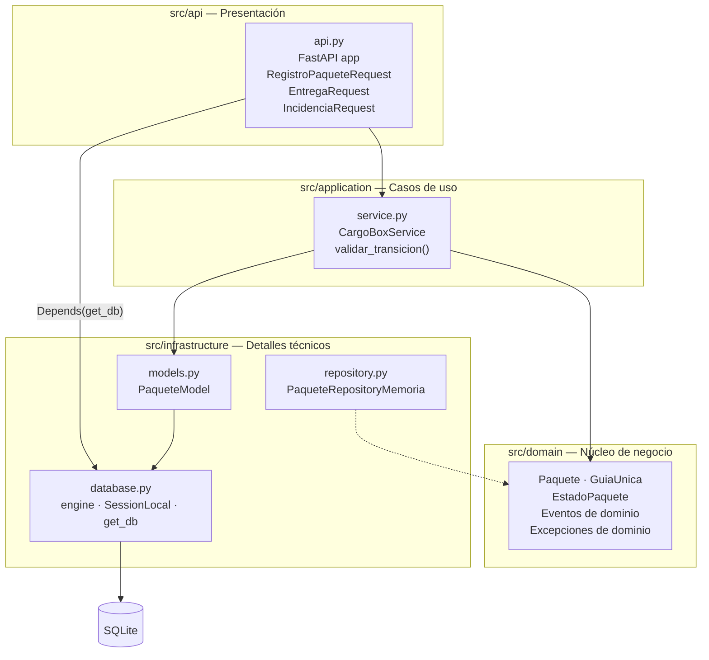
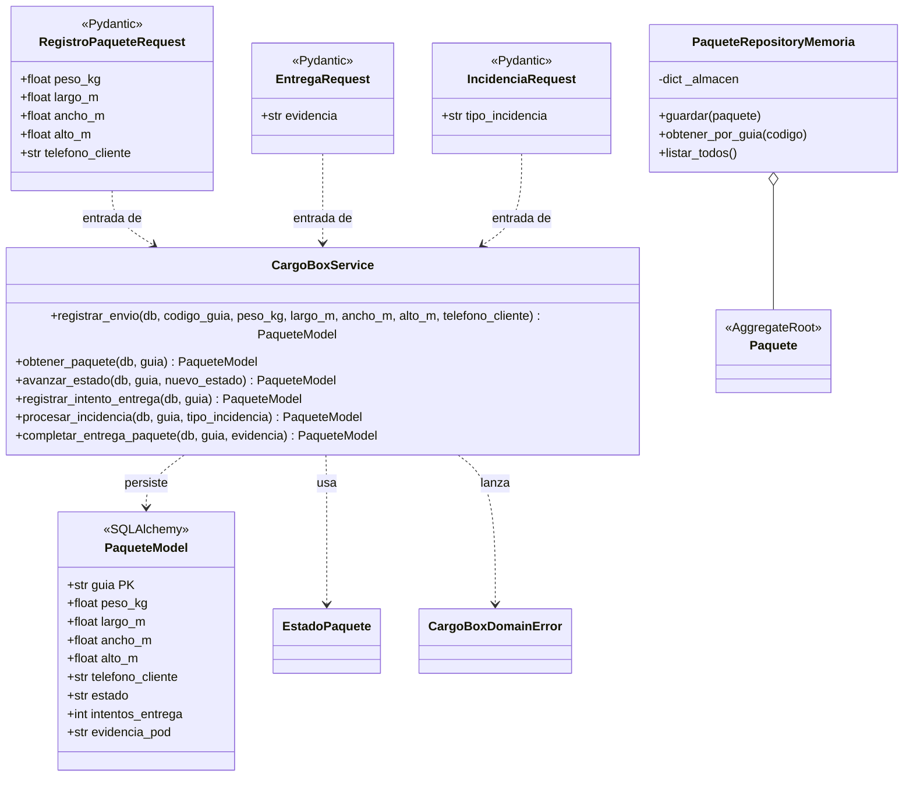
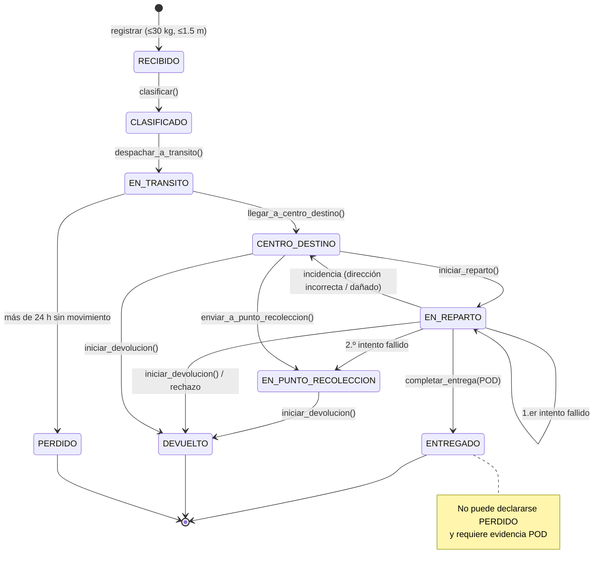
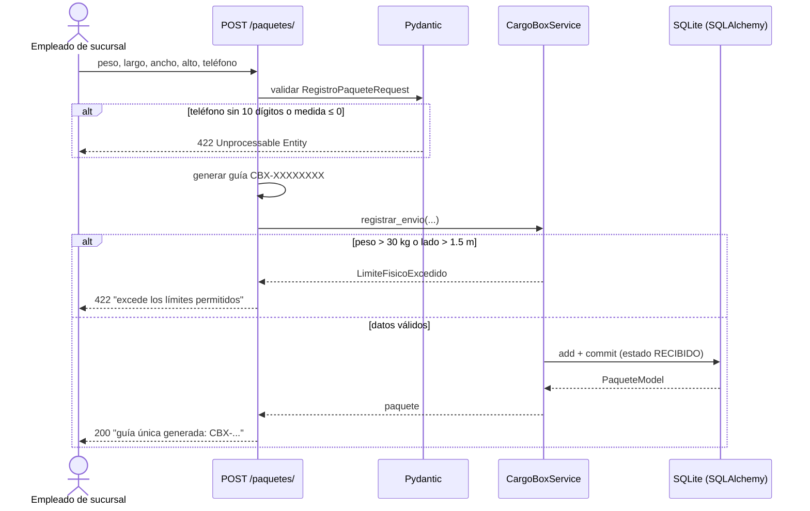
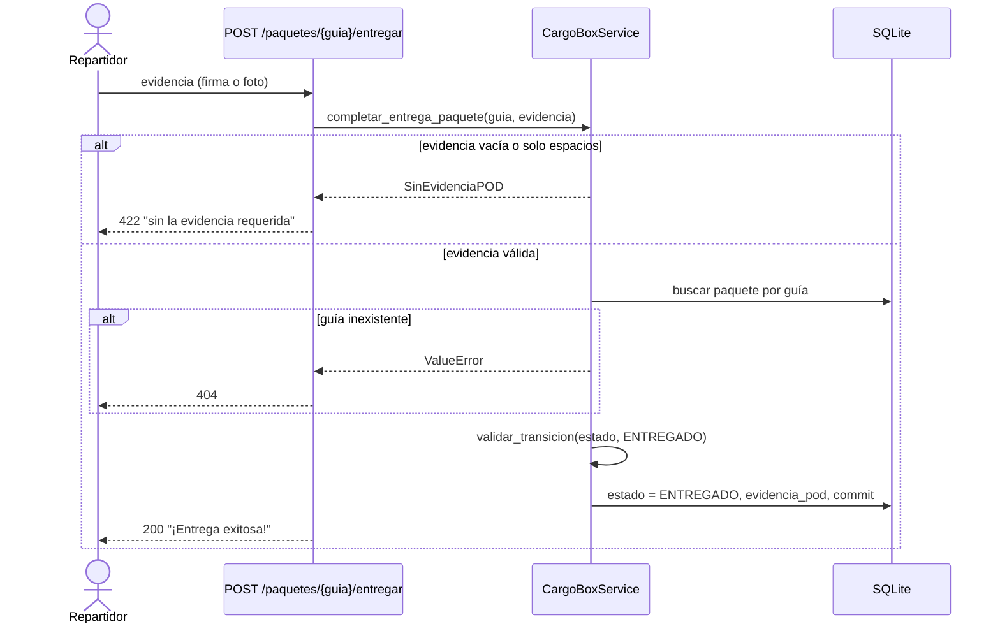
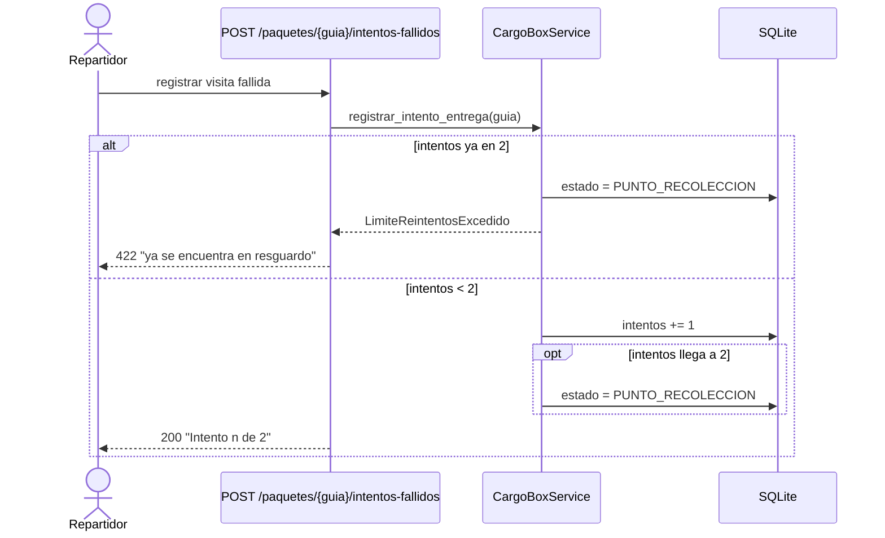
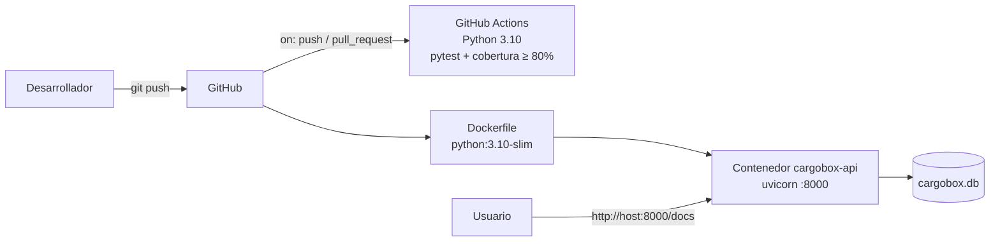

# Diagramas UML y de arquitectura

Todos los diagramas corresponden a clases, métodos y endpoints que existen en `src/`.

## 1. Diagrama de componentes (capas)

## 2. Diagrama de clases de aplicación e infraestructura

## 3. Máquina de estados del paquete

| Desde | Acción | Hacia | Si no se cumple |
|---|---|---|---|
| — | Registrar con peso ≤ 30 kg y dimensión ≤ 1.5 m | RECIBIDO | `LimiteFisicoExcedido` (HTTP 422) |
| RECIBIDO | `clasificar()` | CLASIFICADO | `InvalidStateTransition` (HTTP 409) |
| CLASIFICADO | `despachar_a_transito()` | EN_TRANSITO | `InvalidStateTransition` |
| EN_TRANSITO | `llegar_a_centro_destino()` | CENTRO_DESTINO | `InvalidStateTransition` |
| CENTRO_DESTINO | `iniciar_reparto()` | EN_REPARTO | `InvalidStateTransition` |
| EN_REPARTO | 1.er intento fallido | EN_REPARTO (intentos = 1) | — |
| EN_REPARTO | 2.º intento fallido | EN_PUNTO_RECOLECCION | — |
| EN_PUNTO_RECOLECCION | 3.er intento | — | `LimiteReintentosExcedido` (HTTP 422) |
| EN_REPARTO | `completar_entrega(POD)` | ENTREGADO | `SinEvidenciaPOD` (HTTP 422) |
| EN_TRANSITO | Más de 24 h sin movimiento | PERDIDO | — |

## 4. Secuencia: registrar un paquete

## 5. Secuencia: entrega con evidencia POD

## 6. Secuencia: intentos fallidos

## 7. Despliegue

