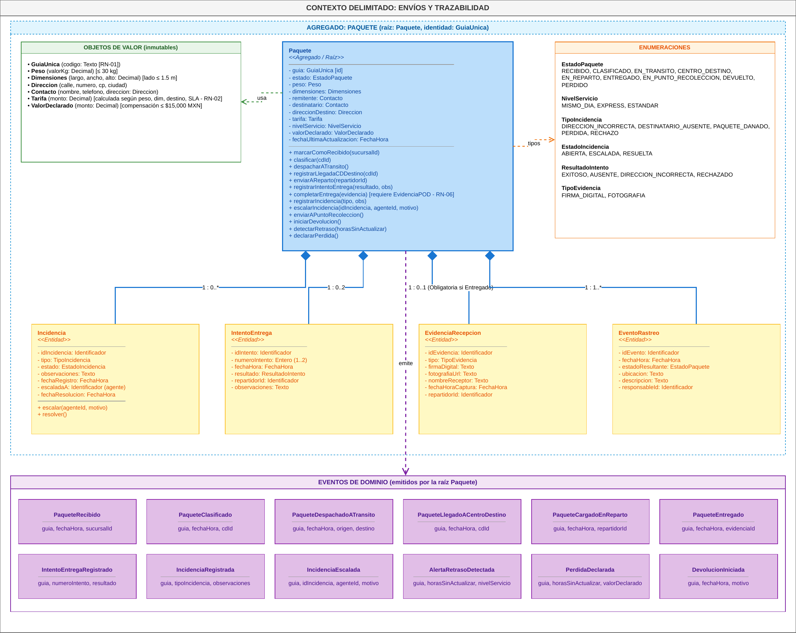

# Del diseño (Unidad 3) a la implementación (PIA)

En la Unidad 3 diseñamos el mapa de dominio y el Service Layer de CargoBox. Para el PIA implementamos el núcleo de ese diseño, el que cubre las reglas obligatorias del BRD, y simplificamos o dejamos fuera de alcance lo demás. Este documento registra esa trazabilidad.

## Mapa de dominio de la Unidad 3

## Modelo de dominio: diseño vs. implementación

| Elemento del diseño U3 | Tipo | En el código | Estado |
|---|---|---|---|
| `Paquete` | Agregado / raíz | `Paquete` en `src/domain/__init__.py` | Implementado |
| `GuiaUnica` | Value Object | `GuiaUnica` (`frozen=True`) | Implementado |
| `Peso` (≤ 30 kg) | Value Object | Atributo `peso_kg` validado en `__post_init__` | Simplificado |
| `Dimensiones` (lado ≤ 1.5 m) | Value Object | Atributo `dimension_max_m` (dominio) y `largo_m`, `ancho_m`, `alto_m` (persistencia) | Simplificado |
| `Contacto`, `Direccion` | Value Objects | `telefono_cliente` de 10 dígitos | Simplificado |
| `Tarifa` (RN-02), `ValorDeclarado` | Value Objects | — | Fuera de alcance (BRD 4: tarifas y pagos) |
| `EstadoPaquete` | Enumeración | `EstadoPaquete` con los mismos 9 estados | Implementado |
| `TipoIncidencia` | Enumeración | Opciones `direccion_incorrecta`, `paquete_danado`, `perdida`, `rechazo`; el destinatario ausente se registra como intento fallido | Simplificado |
| `NivelServicio`, `EstadoIncidencia`, `ResultadoIntento`, `TipoEvidencia` | Enumeraciones | — | Pendiente |
| `IntentoEntrega` (1..2) | Entidad | Contador `intentos_entrega` con límite 2 | Simplificado |
| `EvidenciaRecepcion` | Entidad | `evidencia_pod` (texto obligatorio para ENTREGADO) | Simplificado |
| `EventoRastreo` | Entidad | Lista `eventos` del agregado y `pull_events()` | Simplificado |
| `Incidencia` (escalar, resolver) | Entidad | `procesar_incidencia()` en el servicio | Simplificado |
| `PaqueteRecibido`, `PaqueteEntregado`, `PerdidaDeclarada`, `DevolucionIniciada` | Eventos | `PaqueteRecibido`, `PaqueteEntregado`, `PerdidaDeclarada`, `PaqueteDevuelto` | Implementado |
| `PaqueteClasificado`, `PaqueteDespachadoATransito`, `PaqueteLlegadoACentroDestino`, `PaqueteCargadoEnReparto`, `IntentoEntregaRegistrado`, `IncidenciaRegistrada`, `IncidenciaEscalada`, `AlertaRetrasoDetectada` | Eventos | — | Pendiente |
| `detectarRetraso(horasSinActualizar)` + `declararPerdida()` | Métodos | `verificar_tiempo_transito(horas)` declara PERDIDO tras 24 h en tránsito | Implementado |

## Service Layer: diseño vs. implementación

En la Unidad 3 propusimos cinco servicios. Para el PIA los unimos en `CargoBoxService` porque todos operan sobre el mismo agregado y comparten la sesión de base de datos. Las operaciones se conservan una a una:

| Servicio U3 | Operación diseñada | Método implementado | Endpoint |
|---|---|---|---|
| RecepcionService | `registrarEnvio(cmd) → guía` | `registrar_envio()` | `POST /paquetes/` |
| RutaService | `clasificar(guia, cdId)` | `avanzar_estado(guia, "CLASIFICADO")` | `POST /paquetes/{guia}/clasificar` |
| RutaService | `despacharATransito(guia)` | `avanzar_estado(guia, "EN_TRANSITO")` | `POST /paquetes/{guia}/despachar-transito` |
| RutaService | `registrarLlegadaCDDestino(guia, cdId)` | `avanzar_estado(guia, "CENTRO_DESTINO")` | `POST /paquetes/{guia}/centro-destino` |
| EntregaService | `enviarAReparto(guia, repartidorId)` | `avanzar_estado(guia, "EN_REPARTO")` | `POST /paquetes/{guia}/iniciar-reparto` |
| EntregaService | `registrarIntentoEntrega(cmd)` | `registrar_intento_entrega()` | `POST /paquetes/{guia}/intentos-fallidos` |
| EntregaService | `completarEntrega(cmd)` | `completar_entrega_paquete()` | `POST /paquetes/{guia}/entregar` |
| EntregaService | `enviarAPuntoRecoleccion(guia)` | Automático al 2.º intento fallido | `POST /paquetes/{guia}/intentos-fallidos` |
| IncidenciaService | `registrarIncidencia(cmd)` | `procesar_incidencia()` | `POST /paquetes/{guia}/incidencias` |
| IncidenciaService | `escalarIncidencia(cmd)` | — | Pendiente |
| MonitoreoService | `iniciarDevolucion(guia)` | `procesar_incidencia(..., "rechazo")` | `POST /paquetes/{guia}/incidencias` |
| MonitoreoService | `detectarRetrasos()` | `Paquete.verificar_tiempo_transito()` (dominio) | — |
| MonitoreoService | `declararPerdida(guia)` | `procesar_incidencia(..., "perdida")` | `POST /paquetes/{guia}/incidencias` |
| MonitoreoService | `consultarRastreo(guia)` | `obtener_paquete()` | Pendiente: `GET /paquetes/{guia}` |

El principio del diseño se mantiene: los servicios coordinan y las reglas viven en el agregado. La unificación del servicio y la máquina de estados duplicada están registradas en la deuda técnica de [05-decisiones-tecnicas.md](05-decisiones-tecnicas.md#deuda-técnica-conocida).
