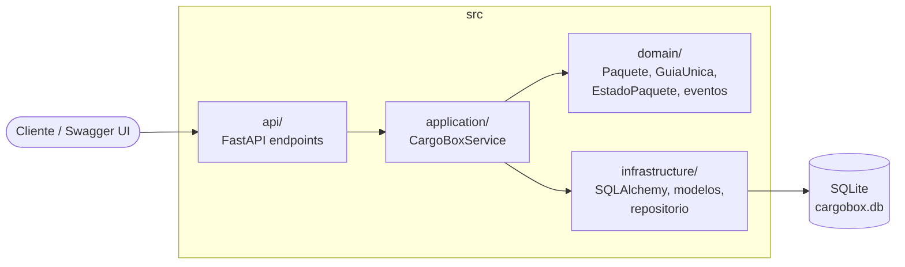

# Arquitectura de CargoBox

Esta carpeta reúne la arquitectura del sistema de gestión logística de CargoBox: el modelo de dominio, los diagramas, los patrones aplicados, los principios SOLID, las decisiones técnicas y los ADR (Architecture Decision Records).

Todos los documentos describen el código que está en `src/` y se pueden comparar directamente con él. Los diagramas usan Mermaid, así que GitHub los muestra como imagen al abrir cada archivo.

| Documento | Contenido |
|---|---|
| [01-modelo-dominio-ddd.md](01-modelo-dominio-ddd.md) | Entidades, Value Objects, agregado, eventos y excepciones de dominio |
| [02-diagramas-uml.md](02-diagramas-uml.md) | Diagrama de capas, clases, máquina de estados y secuencias |
| [03-patrones-diseno.md](03-patrones-diseno.md) | Patrones seleccionados y por qué se eligieron |
| [04-principios-solid.md](04-principios-solid.md) | Dónde se aplica cada principio SOLID en el código |
| [05-decisiones-tecnicas.md](05-decisiones-tecnicas.md) | Stack, configuración, calidad y deuda técnica conocida |
| [06-trazabilidad.md](06-trazabilidad.md) | Relación entre reglas del BRD, código, endpoints y pruebas |
| [07-del-diseno-a-la-implementacion.md](07-del-diseno-a-la-implementacion.md) | Mapa de dominio y Service Layer de la Unidad 3 comparados con el código |
| [adr/](adr/) | Registros de decisiones de arquitectura (ADR-001 a ADR-006) |

## Vista general

La dependencia siempre apunta hacia adentro: la API conoce a la aplicación, la aplicación conoce al dominio y a la infraestructura, y el dominio no importa nada de FastAPI ni de SQLAlchemy.
